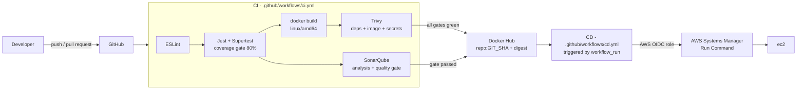
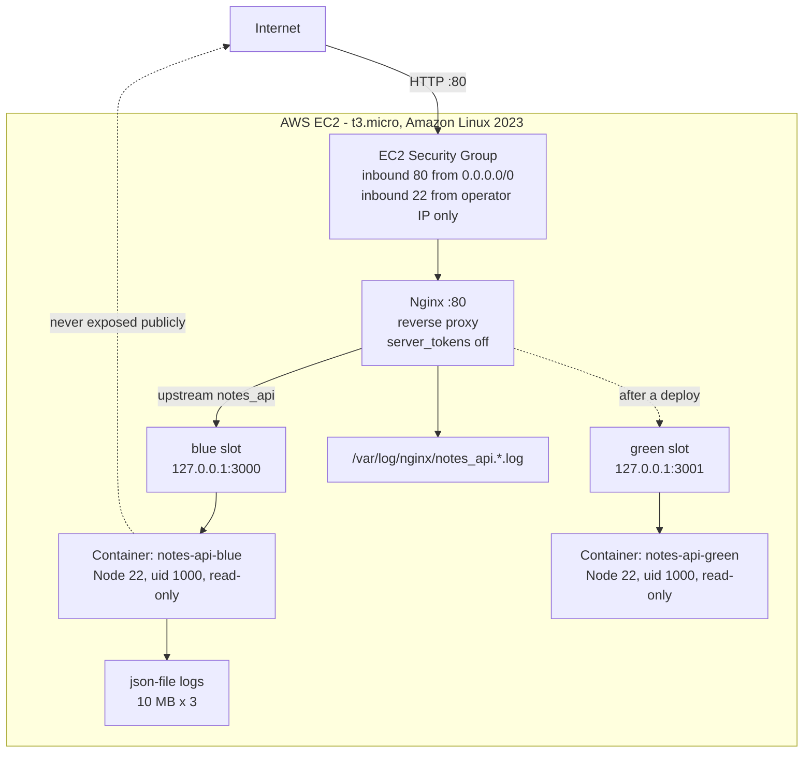
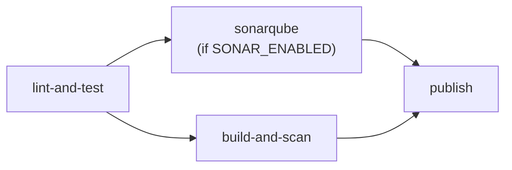
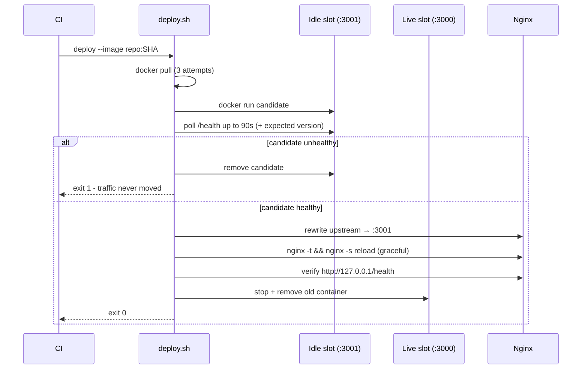

# Production-Grade CI/CD Pipeline with Automated Testing, Code Quality Analysis, Container Security, and AWS EC2 Deployment

A complete, end-to-end delivery pipeline built around a deliberately small Node.js service. The
application is the payload; **the pipeline, the container hardening, the deployment mechanics and
the rollback guarantees are the actual project**.

[](https://github.com/Roushan74/production-cicd-devops-project/actions/workflows/ci.yml)
[](https://github.com/Roushan74/production-cicd-devops-project/actions/workflows/cd.yml)

---

## Table of contents

1. [Project overview](#1-project-overview)
2. [Objectives](#2-objectives)
3. [Architecture](#3-architecture)
4. [Technology stack](#4-technology-stack)
5. [Repository structure](#5-repository-structure)
6. [Local setup](#6-local-setup)
7. [Environment variables](#7-environment-variables)
8. [API reference](#8-api-reference)
9. [Testing](#9-testing)
10. [Docker](#10-docker)
11. [CI pipeline](#11-ci-pipeline)
12. [SonarQube](#12-sonarqube)
13. [Trivy container security](#13-trivy-container-security)
14. [Docker Hub publishing](#14-docker-hub-publishing)
15. [AWS EC2 deployment](#15-aws-ec2-deployment)
16. [Nginx reverse proxy](#16-nginx-reverse-proxy)
17. [Health checks and rollback](#17-health-checks-and-rollback)
18. [Security decisions](#18-security-decisions)
19. [Cost considerations](#19-cost-considerations)
20. [Troubleshooting](#20-troubleshooting)
21. [Cleanup](#21-cleanup)
22. [Known limitations](#22-known-limitations)
23. [Future improvements](#23-future-improvements)

---

## 1. Project overview

`production-cicd-devops-project` is a Notes REST API (Node.js + Express) that is shipped through a
pipeline with the following contract:

> An image reaches production only if it lints, passes every test, satisfies the coverage gate,
> passes the SonarQube quality gate (when configured), and has **zero CRITICAL or HIGH
> vulnerabilities**. It is then deployed to a slot that is health-checked before it receives a
> single request, and any failure rolls back automatically.

The API itself is intentionally minimal — five endpoints, in-memory storage — so that reviewers can
read the whole thing in a few minutes and focus on the delivery engineering.

---

## 2. Objectives

**Business objectives**

- Ship small changes frequently without a manual release process.
- Never publish a container with a known critical vulnerability.
- Never leave production in a broken state after a bad release.
- Keep the cloud bill predictable and small.

**Engineering objectives**

- Reproducible builds: `npm ci`, pinned base image, pinned GitHub Action commit SHAs.
- Fail fast: lint and tests gate everything downstream.
- Defence in depth: non-root container, read-only root filesystem, dropped capabilities,
  no published application port, least-privilege security group.
- Verifiable deployments: a release is only "done" when the public endpoint has been checked.
- No long-lived cloud credentials in CI — AWS access is obtained through GitHub OIDC.

---

## 3. Architecture

### Delivery pipeline



### Runtime architecture



Only port 80 is reachable from the internet. The application containers bind to `127.0.0.1`, so
even though they publish a port, it is not routable from outside the instance.

### Request flow (production)

```
Client
  │  GET /api/notes
  ▼
EC2 Security Group            allows tcp/80 only
  ▼
Nginx :80                     sets X-Real-IP, X-Forwarded-For, X-Request-Id
  │                           server_tokens off, 64k body limit, 5s connect timeout
  ▼
upstream notes_api            → 127.0.0.1:3000  (blue)  or  127.0.0.1:3001 (green)
  ▼
Docker port mapping           127.0.0.1:3000 → container:3000
  ▼
Node.js / Express             helmet → json(32kb) → requestId → access log
  │                           → router → controller → service
  ▼
JSON response                 + X-Request-Id echoed back
```

If both slots are down, Nginx returns a JSON `503 UPSTREAM_UNAVAILABLE` rather than an HTML error
page, so clients can parse the failure.

---

## 4. Technology stack

| Layer | Technology | Version |
| --- | --- | --- |
| Runtime | Node.js | 22.22.2 (LTS) |
| Framework | Express | 5.3.0 |
| Security headers | helmet | 8.3.0 |
| Tests | Jest / Supertest | 30.5.2 / 7.3.1 |
| Linting | ESLint (flat config) | 10.13.0 |
| Container | Docker multi-stage | node:22.22.2-alpine |
| Registry | Docker Hub | — |
| CI/CD | GitHub Actions | pinned by commit SHA |
| Code quality | SonarQube Cloud / Server | scanner action v5.3.0 |
| Container security | Trivy | action v0.36.0 / CLI 0.76.1 |
| Cloud | AWS EC2 + SSM + IAM | Amazon Linux 2023 |
| Reverse proxy | Nginx | 1.29 (host install) |
| Scripting | Bash 5 | `set -Eeuo pipefail` everywhere |

---

## 5. Repository structure

```
project-1/
├── src/
│   ├── app.js                    Express app factory (no listener - testable)
│   ├── server.js                 listener, seeding, graceful shutdown
│   ├── config/index.js           validated env configuration
│   ├── routes/index.js           route table
│   ├── controllers/              HTTP layer only
│   ├── services/notes.service.js in-memory repository
│   ├── middleware/               validation, error handling, request logging
│   └── utils/                    AppError, structured logger
├── tests/                        Jest + Supertest (33 tests)
├── scripts/
│   ├── bootstrap-server.sh       one-time EC2 setup (Docker + Nginx)
│   ├── provision-aws.sh          idempotent AWS resource creation
│   ├── deploy.sh                 blue/green deploy with health gate
│   ├── rollback.sh               revert to the previous image
│   ├── health-check.sh           contract-level smoke test
│   ├── ssm-deploy.sh             run a deploy through AWS SSM
│   └── cleanup-aws.sh            delete only project-tagged resources
├── nginx/
│   ├── default.conf              server block, timeouts, logging, 503 fallback
│   └── upstream.conf             the blue/green switch (rewritten by deploy.sh)
├── .github/workflows/
│   ├── ci.yml                    lint → test → sonar → build → scan → publish
│   └── cd.yml                    workflow_run → OIDC → SSM → deploy → verify
├── Dockerfile                    multi-stage, non-root, npm removed
├── docker-compose.yml            single-service local stack
├── docs/                         architecture, setup, deployment, troubleshooting
├── sonar-project.properties
├── .trivyignore                  policy file - intentionally empty
└── README.md
```

---

## 6. Local setup

**Prerequisites:** Node.js 22+, npm 10+, Docker Desktop, Git.

```bash
git clone https://github.com/Roushan74/production-cicd-devops-project.git
cd production-cicd-devops-project
npm ci

# Optional: local overrides (never commit .env)
cp .env.example .env

npm start          # http://localhost:3000
npm run dev        # watch mode
```

Verify:

```bash
curl -s http://localhost:3000/health | jq
curl -s http://localhost:3000/api/notes | jq
```

The API seeds two demonstration notes on start-up so the endpoint is never empty on a fresh boot.

---

## 7. Environment variables

All settings have safe defaults; none of them is a secret.

| Variable | Default | Purpose |
| --- | --- | --- |
| `NODE_ENV` | `development` | `production` disables verbose errors |
| `PORT` | `3000` | Container listens on 3000 |
| `HOST` | `0.0.0.0` | Required inside a container |
| `APP_NAME` | `notes-api` | Reported by `/health` |
| `APP_VERSION` | `package.json` version | Overridden at build time |
| `LOG_LEVEL` | `info` | `error` / `warn` / `info` / `debug` |
| `SHUTDOWN_TIMEOUT_MS` | `10000` | Graceful shutdown grace period |
| `TRUST_PROXY` | `1` | Trusted proxy hops (Nginx) |
| `MAX_NOTES` | `1000` | In-memory safety limit |

Invalid values fail fast at boot:

```
Error: Invalid configuration: PORT="abc" must be an integer between 1 and 65535
```

**Secrets never live here.** `DOCKERHUB_USERNAME`, `DOCKERHUB_TOKEN`, `SONAR_TOKEN` and AWS access are
supplied through GitHub Actions Secrets and GitHub OIDC. See [SECURITY.md](SECURITY.md).

---

## 8. API reference

### `GET /health`

```bash
curl -s http://localhost:3000/health
```

```json
{
  "application": "notes-api",
  "status": "ok",
  "version": "1.0.0",
  "environment": "production",
  "uptimeSeconds": 42,
  "notesStored": 2,
  "timestamp": "2026-10-25T05:27:13.116Z"
}
```

`200 OK` when healthy. Used by the Docker `HEALTHCHECK`, by `deploy.sh` before traffic is switched,
and by the post-deployment smoke test.

### `GET /api/notes`

```bash
curl -s http://localhost:3000/api/notes
```

```json
{
  "data": [
    {
      "id": "35ccdddf-8c46-4c0f-b897-144fa4d7b74d",
      "title": "Welcome to the Notes API",
      "content": "This note is seeded at start-up...",
      "createdAt": "2026-10-25T05:27:11.758Z",
      "updatedAt": "2026-10-25T05:27:11.758Z"
    }
  ],
  "meta": { "count": 1 }
}
```

### `GET /api/notes/:id`

| Case | Status | `error.code` |
| --- | --- | --- |
| Found | `200` | — |
| Well-formed UUID, not stored | `404` | `NOTE_NOT_FOUND` |
| Not a UUID | `400` | `INVALID_NOTE_ID` |

### `POST /api/notes`

```bash
curl -s -X POST http://localhost:3000/api/notes \
  -H 'Content-Type: application/json' \
  -d '{"title":"Deploy checklist","content":"Run the smoke test"}'
```

```json
{
  "data": {
    "id": "0a238e01-d524-4943-a472-f30e49d5fd39",
    "title": "Deploy checklist",
    "content": "Run the smoke test",
    "createdAt": "2026-10-25T05:27:13.201Z",
    "updatedAt": "2026-10-25T05:27:13.201Z"
  }
}
```

`201 Created` with `Location: /api/notes/<id>`. Validation rules: `title` required, ≤ 120 chars;
`content` required, ≤ 5000 chars; unknown fields rejected; body must be a JSON object.

### `DELETE /api/notes/:id`

`200` with the deleted note and `meta.deleted = true`, or `404 NOTE_NOT_FOUND`.

### Error envelope

Every failure uses one shape, including a correlation id that also appears in the logs:

```json
{
  "error": {
    "code": "VALIDATION_ERROR",
    "message": "Request validation failed",
    "details": [{ "field": "title", "message": "title is required..." }],
    "requestId": "fdb5d4dc-fc3c-42e7-9811-90899be695d3"
  }
}
```

---

## 9. Testing

```bash
npm test              # 33 tests
npm run test:coverage # with coverage report
npm run test:ci       # CI mode, coverage enforced
npm run lint
```

Current state on this machine:

| Metric | Result |
| --- | --- |
| Test suites | 4 passed |
| Tests | 33 passed |
| Statements | 95.78% |
| Branches | 91.95% |
| Functions | 88.88% |
| Lines | 97.25% |
| Coverage gate | 80% statements/lines, 75% branches (fails the build below this) |

What is covered:

- every endpoint, success and failure path;
- validation: missing fields, wrong types, whitespace-only, over-long, unknown fields;
- malformed JSON (`400 INVALID_JSON`) and oversized payload (`413 PAYLOAD_TOO_LARGE`);
- unknown routes (`404 ROUTE_NOT_FOUND`);
- malformed UUID (`400`) vs unknown UUID (`404`);
- unexpected exceptions produce `500 INTERNAL_ERROR` **without** leaking stack traces;
- access logs contain no request bodies, `Authorization` headers or tokens;
- configuration validation (invalid `PORT` fails at boot);
- defensive copies: callers cannot mutate stored notes.

`src/server.js` is excluded from coverage: it is process bootstrap (signal handlers, `listen`) and is
verified by the container health check and deployment smoke test instead of a unit test. This is
declared in `jest.config.js`, not hidden.

---

## 10. Docker

### Image vs container

An **image** is the immutable, layered artefact built from the `Dockerfile` — a filesystem plus
metadata, with no running process. A **container** is a running (or stopped) instance of that image
with its own writable layer, network namespace and PID namespace. The same image `…:a1b2c3d` can run
as many containers as you like; the image is what CI builds, scans and pushes, and the container is
what actually serves traffic.

### Build and run

```bash
docker build --platform linux/amd64 -t production-cicd-devops-project:local .
docker run -d --name notes-api -p 3000:3000 production-cicd-devops-project:local

curl -s localhost:3000/health | jq
docker inspect --format '{{.State.Health.Status}}' notes-api   # healthy
```

Or with Compose:

```bash
docker compose up -d --build
docker compose ps
docker compose down
```

### Image design

| Decision | Reason |
| --- | --- |
| Two stages | Production dependencies are installed in a throw-away stage, so npm's cache and install logs never reach the shipped image |
| `npm ci --omit=dev --ignore-scripts` | Reproducible, no dev dependencies, no arbitrary postinstall code |
| `USER node` (uid 1000) | The process cannot write to `/app` or escalate |
| Source owned by `root` | A compromised process cannot patch its own code |
| `apk upgrade` at build | Pulls patched OS packages (OpenSSL) published after the base tag |
| **npm removed** | npm is not needed at runtime and its bundled tree (`tar`, `pacote`, `sigstore`, `brace-expansion`, `picomatch`, `ip-address`) accounted for 9 of 13 HIGH/CRITICAL findings |
| `HEALTHCHECK` using `node -e fetch(...)` | No curl/wget in the image |
| Exec-form `CMD`, `STOPSIGNAL SIGTERM` | Node is PID 1 and receives the signal directly |
| `.dockerignore` | No `.env`, `.git`, SSH keys, tests, docs or CI metadata in the build context |

Verified on this machine:

| Check | Result |
| --- | --- |
| Build (`linux/amd64`) | success |
| Image size | 61.1 MB |
| Container user | `uid=1000(node) gid=1000(node)` |
| Health status | `healthy` |
| Write to `/app` | `Permission denied` |
| Dev dependencies present | none (`jest`, `eslint`, `supertest` absent) |
| `npm` present | removed |
| Graceful shutdown | `SIGTERM` → `server.shutdown.completed`, exit 0 |
| Restart | clean, health restored |

---

## 11. CI pipeline

`.github/workflows/ci.yml` — triggered on pull requests to `main`, pushes to `main`, and manual
dispatch. Default token permission is `contents: read`; each job opts in only to what it needs.



| Job | What it does | Gate |
| --- | --- | --- |
| `lint-and-test` | `npm ci`, ESLint, Jest with coverage | any failure stops the pipeline |
| `sonarqube` | scan + quality gate | red gate blocks publishing |
| `build-and-scan` | build `linux/amd64`, Trivy deps + image + secrets, SARIF | any CRITICAL/HIGH finding fails the job |
| `publish` | load the **exact scanned bytes**, tag with `GITHUB_SHA`, push | only on `push` to `main` |

Why the image is exported and re-loaded between `build-and-scan` and `publish`: the bytes that were
scanned are the bytes that get pushed. There is no rebuild, so there is no window in which a
different artefact could reach the registry.

**A pull request can never deploy.** `publish` is gated on `github.event_name == 'push' &&
github.ref == 'refs/heads/main'`, and `cd.yml` is triggered by `workflow_run`, which does not run for
pull requests from forks.

**Third-party actions are pinned to commit SHAs:**

| Action | Version | Commit SHA |
| --- | --- | --- |
| `actions/checkout` | v4.2.2 | `11d5960a…f677262` |
| `actions/setup-node` | v4.4.0 | `49933ea5…7d6820020` |
| `actions/upload-artifact` | v4.6.2 | `ea165f8d…607fa02` |
| `actions/download-artifact` | v4.3.0 | `d3f86a10…df5c8093` |
| `docker/setup-buildx-action` | v3.10.0 | `8d2750c6…3b4cbd6f` |
| `docker/build-push-action` | v6.13.0 | `10e90e36…33f178e8` |
| `docker/login-action` | v3.4.0 | `c94ce9fb…6fe4bcc9` |
| `aquasecurity/trivy-action` | v0.36.0 | `ed142fd0…e5ce36c25` |
| `github/codeql-action` | v3.29.2 | `4bfa242a…dfac05f8` |
| `SonarSource/sonarqube-scan-action` | v5.3.0 | `2f77a1ec…5bdef703` |
| `SonarSource/sonarqube-quality-gate-action` | v1.1.0 | `7a5fffe8…03e52efa` |
| `aws-actions/configure-aws-credentials` | v4.1.0 | `7474bc46…536d5c3a` |

---

## 12. SonarQube

`sonar-project.properties` analyses `src/` as production code and `tests/` as test code, excludes
dependencies/build output/docs, and attaches the Jest LCOV report. `sonar.qualitygate.wait=true` plus
the `sonarqube-quality-gate-action` step means a red gate fails the job, which prevents publishing.

The job only runs when the repository variable **`SONAR_ENABLED` is `true`**. When it is not
configured the job is *skipped*, and the publish job emits an explicit warning annotation:

```
::warning title=SonarQube not configured::SONAR_ENABLED is not 'true' -
SonarQube analysis and its quality gate did NOT run for this commit.
```

A skipped integration is never reported as a success.

**To enable it** (5 minutes, free tier available):

1. Sign in at <https://sonarcloud.io> with GitHub and import this repository.
2. Copy the organisation key into `sonar.organization` in `sonar-project.properties`
   (currently `roushan74`).
3. Generate a token → add repository secret `SONAR_TOKEN`.
4. Add repository variable `SONAR_HOST_URL` = `https://sonarcloud.io`
   (omit for a self-hosted server, or set your own URL).
5. Add repository variable `SONAR_ENABLED` = `true`.
6. Configure the quality gate (default "Sonar way" is fine) and make it the project default.

> Status: **configured, not yet verified** — no SonarQube account/token was available in this
> environment, so no analysis has been executed. No result is claimed.

---

## 13. Trivy container security

Three distinct scans run in CI, because they answer different questions:

| Scan | Question it answers | Command |
| --- | --- | --- |
| **Dependency (SCA)** | Do the libraries we ship have known CVEs? | `trivy fs --scanners vuln .` |
| **Container image** | Do the OS packages *and* the bundled libraries have known CVEs? | `trivy image <ref>` |
| **Secrets / misconfig** | Did a credential or a bad Dockerfile setting slip in? | `trivy image --scanners secret,misconfig` |

These are **not** runtime security. Trivy is a static scanner: it reports *known* vulnerabilities in
*installed* versions. It cannot tell you whether a vulnerable code path is reachable, whether the
process is being exploited at runtime, or whether a zero-day is present. Runtime security is a
separate control (Falco, GuardDuty Runtime Monitoring, seccomp/AppArmor profiles) and is listed
under [Future improvements](#23-future-improvements).

Policy:

- Blocking threshold: **CRITICAL and HIGH**, with `exit-code: 1`.
- `--ignore-unfixed` is enabled: a finding with no available fix cannot be remediated by any action
  in this pipeline, so blocking on it would only encourage suppression. This is a documented,
  repo-wide policy visible in `ci.yml` — not a per-finding exemption.
- `.trivyignore` is **empty on purpose**, and its header states the three conditions required before
  an entry may be added.
- SARIF is generated and uploaded to GitHub code scanning on public repositories (where GitHub
  Advanced Security is free). The blocking gate does not depend on that upload.

Result on the image built in this project:

```
Before hardening: 13 HIGH/CRITICAL   (4 OpenSSL in the base image, 9 in npm's bundled tree)
After hardening :  0 vulnerabilities of any severity, 0 secrets
Dependency scan :  0 vulnerabilities (package-lock.json)
```

The fix was real remediation — `apk upgrade` for OpenSSL and deleting npm from the runtime image —
not suppression.

---

## 14. Docker Hub publishing

| Item | Value |
| --- | --- |
| Repository | `docker.io/<DOCKERHUB_USERNAME>/production-cicd-devops-project` |
| Immutable tag | full 40-character `GITHUB_SHA` |
| Convenience tag | `latest` (never used as a deployment reference) |
| Digest | recorded in the job summary and available via `docker buildx imagetools inspect` |

Required secrets: `DOCKERHUB_USERNAME`, `DOCKERHUB_TOKEN` (an access token with *Read & Write*, not
the account password).

Deployment always references the SHA tag, never `latest`, so a rollback or a re-deploy is pinned to
exact bytes.

> Status: **configured, not yet verified** — no Docker Hub credentials were available, so no image
> has been pushed from CI. The workflow is complete and will publish as soon as the two secrets
> exist.

---

## 15. AWS EC2 deployment

### Design

- **One** `t3.micro` in the default VPC, Amazon Linux 2023, 8 GiB encrypted gp3 root volume,
  IMDSv2 required.
- **Security group**: inbound `tcp/80` from `0.0.0.0/0`; inbound `tcp/22` from the operator's public
  IP `/32` only — never `0.0.0.0/0`. No other inbound ports.
- **IAM instance profile** with `AmazonSSMManagedInstanceCore`, so the host can be administered and
  deployed to through Systems Manager **without inbound SSH at all**.
- **Deployment transport**: `cd.yml` assumes an IAM role via GitHub OIDC (no static AWS keys) and
  calls `ssm:SendCommand`. The same `deploy.sh` that runs locally runs on the host.
- **No NAT gateway, no load balancer, no ECS/EKS** — the cheapest architecture that meets the
  requirements.

### Provision

```bash
./scripts/provision-aws.sh --dry-run     # plan + cost estimate, creates nothing
./scripts/provision-aws.sh               # creates SG, IAM role/profile, instance
```

State is written to `.deploy/aws-state.env` (git-ignored). The script is idempotent and never
deletes anything.

### Deploy

```bash
# from a laptop or CI, through SSM (no SSH needed)
./scripts/ssm-deploy.sh --instance i-xxxx --image <user>/production-cicd-devops-project:<sha>

# on the host itself
sudo ./scripts/bootstrap-server.sh   # once
./scripts/deploy.sh --image <ref>
```

---

## 16. Nginx reverse proxy

`nginx/default.conf` is installed at `/etc/nginx/conf.d/notes-api.conf`; the upstream block lives in
`/etc/nginx/notes-upstream.conf` and is the blue/green switch.

| Setting | Value | Why |
| --- | --- | --- |
| `server_tokens off` | — | Do not advertise the Nginx version |
| `client_max_body_size` | `64k` | The API accepts small JSON only |
| `proxy_connect_timeout` | `5s` | Fail fast when a slot is dead |
| `proxy_read_timeout` | `30s` | Normal requests finish |
| `proxy_set_header X-Forwarded-For` | `$proxy_add_x_forwarded_for` | Real client IP in logs |
| `proxy_set_header X-Request-Id` | `$request_id` | Correlate Nginx ↔ Node logs |
| `proxy_http_version 1.1` + `Connection ""` | — | Keepalive to the upstream |
| `error_page 502 503 504` | `@upstream_unavailable` | JSON 503, not an HTML page |
| `location = /health` | `access_log off` | Health polling would flood the log |

Validate before every reload — `deploy.sh` refuses to reload if `nginx -t` fails:

```bash
sudo nginx -t && sudo nginx -s reload
```

HTTPS is **not** configured: there is no domain pointing at this instance, and no certificate has
been issued. The config is HTTP-only and this README does not claim otherwise.

---

## 17. Health checks and rollback

`deploy.sh` implements blue/green on a single host:



Guarantees:

1. Traffic moves only after the new version passes its own health check.
2. `nginx -s reload` is graceful: in-flight requests finish on the old worker.
3. If verification *after* the switch fails, the upstream file is reverted automatically (trap).
4. The previous image is recorded in `/opt/notes-api/state/previous_image` and is never deleted —
   only dangling layers are pruned, so a rollback always has its artefact available.
5. `rollback.sh` reuses the same verified path, so a rollback is health-checked too.

Verified on this machine (containerised Nginx, two image versions):

| Scenario | Result |
| --- | --- |
| First deploy (v1.0.0) | blue slot, `version 1.0.0` live |
| Second deploy (v1.1.0) | green slot, traffic switched, `version 1.1.0` live |
| **120 requests during the switch** | **120 × HTTP 200 — zero failed requests** |
| Rollback | `version 1.0.0` restored, previous pointer updated |
| Deploy with unmet version expectation | rejected, candidate removed, traffic stayed on v1.0.0, state unchanged |
| `health-check.sh` against a dead host | non-zero exit |

`docs/screenshots/` and the transcripts in [docs/deployment.md](docs/deployment.md) contain the real
output from these runs.

---

## 18. Security decisions

| Area | Decision |
| --- | --- |
| Secrets | GitHub Actions Secrets + GitHub OIDC → AWS STS. No static AWS keys, no `.env` in Git or in the image. |
| Token permissions | Workflow default `contents: read`; jobs opt in. `cd.yml` needs `id-token: write` only. |
| Container | Non-root uid 1000, read-only root filesystem, `no-new-privileges`, `cap_drop: ALL`, 256 MB memory cap, source owned by root. |
| Network | Only 80/tcp public. App binds `127.0.0.1`. SSH limited to one /32. SSM preferred over SSH. |
| Input | Strict validation, unknown fields rejected, 32 kB body limit, 64 kB Nginx limit. |
| Errors | Stack traces are logged, never returned. Verified by a test that asserts a connection string cannot appear in a 500 response. |
| Logging | Structured JSON, sensitive keys redacted, no bodies or headers logged, `requestId` correlation. |
| Supply chain | `npm ci`, pinned action SHAs, pinned base image, `npm audit` available as `npm run audit:prod`. |
| Scanner honesty | No blanket ignores; `.trivyignore` empty with a written policy. |
| Git | `.gitignore` blocks `.env*`, keys, certificates, `.deploy/`. |

See [SECURITY.md](SECURITY.md) for the disclosure policy and the full control list.

---

## 19. Cost considerations

Region `us-east-1`, on-demand, ~730 h/month:

| Resource | Rate | Monthly |
| --- | --- | --- |
| EC2 `t3.micro` | $0.0104/h | ~$7.59 |
| EBS gp3 8 GiB | ~$0.08/GB-month | ~$0.64 |
| Public IPv4 | $0.005/h | ~$3.65 |
| Data transfer out | first 100 GB free | ~$0.00 |
| **Indicative total** | | **~$11.9/month** |

Notes:

- Free-tier eligibility is **not assumed**. This account already contains resources and may be
  outside any free-tier window; `provision-aws.sh` prints this caveat before creating anything.
- **Stopping the instance does not remove all charges** — EBS and the public IPv4 address continue
  to bill.
- No NAT Gateway (~$32/month), no load balancer (~$16/month), no EKS control plane (~$73/month).
- GitHub Actions minutes are free for public repositories.

---

## 20. Troubleshooting

| Symptom | Cause | Fix |
| --- | --- | --- |
| `Invalid configuration: PORT=...` at boot | Non-numeric or out-of-range `PORT` | Fix the env var — this is a deliberate fail-fast |
| Container `unhealthy` | App not listening on `0.0.0.0` | Check `HOST`; inside a container `127.0.0.1` is unreachable from the health check |
| `502` from Nginx | Both slots down | `docker ps`, `docker logs notes-api-blue`, `systemctl status docker` |
| `503 UPSTREAM_UNAVAILABLE` JSON | Upstream dead, fallback working | Same as above; Nginx is healthy, the app is not |
| Deploy says "candidate did not become healthy" | Image broken, or `--expect-version` mismatch | `docker logs notes-api-green`; traffic was not moved |
| `nginx -t` fails after a deploy | Upstream file malformed | The file is generated — check `/etc/nginx/notes-upstream.conf`; `deploy.sh` reverts on failure |
| SSM `Instance is not SSM-managed` | Missing instance profile or agent | Attach `AmazonSSMManagedInstanceCore`, check `systemctl status amazon-ssm-agent` |
| `docker pull` 401 | Private repo or missing login | Make the Docker Hub repo public, or `docker login` on the host |
| CI: `SONAR_ENABLED` warning | Sonar not configured | Expected; see [§12](#12-sonarqube) |

More detail: [docs/troubleshooting.md](docs/troubleshooting.md).

---

## 21. Cleanup

```bash
./scripts/cleanup-aws.sh --dry-run   # list exactly what would be deleted
./scripts/cleanup-aws.sh --yes       # terminate instance, delete SG, IAM role/profile
```

Only resources tagged `Project=production-cicd-devops-project` are touched. Unrelated resources in
the account (including a pre-existing instance found during the environment audit) are never listed
and never deleted.

Local cleanup:

```bash
docker compose down
docker rmi production-cicd-devops-project:local
```

---

## 22. Known limitations

Stated plainly, because a portfolio project that overclaims is worse than a smaller honest one:

1. **In-memory storage.** Notes live in a process-local `Map`. They are lost on restart and are not
   shared between slots. This is deliberate; adding a database would add cost without demonstrating
   anything new about CI/CD.
2. **Single instance.** No horizontal scaling, no load balancer. Zero downtime is achieved *per
   deployment* through blue/green, not through redundancy — if the instance dies, the service is
   down.
3. **HTTPS is not configured.** No domain, no certificate.
4. **SonarQube is configured but never executed** in this environment (no account/token).
5. **Docker Hub publishing is configured but never executed** (no credentials).
6. **AWS deployment requires approval and was not performed autonomously** — creating billable
   infrastructure needs the account owner's consent. Scripts and workflows are complete and the
   deployment logic is verified locally.
7. **The `latest` tag exists** for convenience; deployment never uses it.
8. **Trivy reports known CVEs only** — it is not runtime protection, and it cannot judge
   exploitability.
9. **Single-region, single-AZ.** No disaster recovery.

---

## 23. Future improvements

- Replace the in-memory store with Postgres + migrations, and a real integration-test stage.
- Add HTTPS via ACM + ALB, or certbot on the host with a real domain.
- Move to ECS Fargate or EKS behind an ALB when horizontal scaling is required.
- Add a runtime security layer (Falco or GuardDuty Runtime Monitoring) and seccomp/AppArmor profiles.
- Add `docker scout` or Cosign image signing plus admission verification of the digest.
- Add Terraform/OpenTofu for the AWS resources instead of imperative Bash.
- Add a staging environment and a manual approval gate before production.
- Add k6 load tests as a post-deploy verification step.

---

## License

MIT — see [LICENSE](LICENSE).
