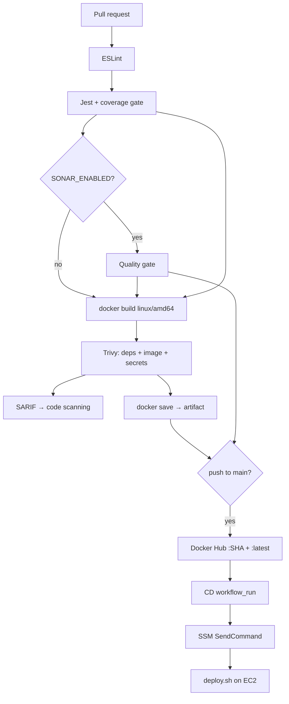

# Architecture

This document explains *why* the system is shaped the way it is. The README describes what exists;
this file records the reasoning and the trade-offs.

---

## 1. Design principles

1. **The pipeline is the product.** The application is intentionally small so that the delivery
   mechanics are readable in one sitting.
2. **One artefact, promoted.** The image built in CI is the image that is scanned, pushed, pulled and
   run. It is never rebuilt for a different environment.
3. **Nothing reaches production unverified.** Every transition — merge, publish, deploy — has a gate
   that can say no.
4. **Fail loudly, fail early.** Configuration is validated at boot; the pipeline stops at the first
   red gate; a failed deploy leaves production untouched.
5. **No secret in a file.** Credentials are injected at runtime from a managed store.

---

## 2. Component responsibilities

| Component | Owns | Explicitly does not own |
| --- | --- | --- |
| `src/app.js` | Middleware order, route mounting | Listening on a port |
| `src/server.js` | Listener, seeding, signal handling | Business logic |
| `src/routes` | URL → controller mapping | Validation rules |
| `src/middleware` | Validation, error translation, request context | Data access |
| `src/controllers` | HTTP in/out | Storage details |
| `src/services` | Data rules, ID validation, limits | HTTP concepts |
| `src/config` | Env parsing + validation | Secrets |
| `src/utils/logger` | Structured output, redaction | Log shipping |

`app.js` returns an Express app **without** calling `listen`. That single decision is what lets
Supertest exercise the real middleware stack — helmet, JSON parsing, validation, error handling — in
milliseconds and without a port.

---

## 3. Request lifecycle

```
helmet()                 security headers, removes X-Powered-By
express.json(32kb)       parses and rejects oversized bodies (413)
requestContext           assigns/echoes X-Request-Id
accessLog                starts a timer, logs on 'finish' (path only)
router                   /health, /api/notes...
validateCreateNote       field-level validation → 400 with all errors
controller               calls the service
service                  throws AppError for domain failures
notFoundHandler          unmatched route → 404 ROUTE_NOT_FOUND
errorHandler             AppError → its status; anything else → 500 (stack logged only)
```

Middleware order matters: the request id is assigned *before* anything can fail, so even a 500
response carries a correlation id that matches a log line.

---

## 4. Error model

Two categories, one response shape:

- **Operational** (`AppError`): expected failures — validation, not found, payload too large. The
  status, code and message are returned to the client.
- **Programmer/unexpected**: anything else. The client receives a generic
  `500 INTERNAL_ERROR`; the stack goes to the log.

```json
{ "error": { "code": "...", "message": "...", "details": [], "requestId": "..." } }
```

The response **never** contains a stack trace, in any environment. This was a deliberate change: an
early implementation returned the stack outside production, and a test caught a database connection
string inside it. The fix was to remove the stack from responses entirely, not to relax the test.

---

## 5. Delivery pipeline



### Why `docker save` between jobs

`build-and-scan` produces `/tmp/image.tar` and uploads it as an artifact. `publish` downloads and
loads it. The alternative — rebuilding in `publish` — would publish bytes that were never scanned.
The cost is ~60 MB of artifact transfer; the benefit is that the scanned artefact and the published
artefact are provably identical.

### Why `workflow_run` for CD

A `workflow_run` trigger on the CI workflow means:

- only successful CI runs on `main` can deploy;
- fork pull requests cannot reach the deployment workflow at all, so they can never obtain AWS
  credentials;
- the deployment input is a commit SHA that CI has already validated.

---

## 6. Runtime topology

Single EC2 instance, two container slots, one Nginx.

| Element | Port | Exposure |
| --- | --- | --- |
| Nginx | 80 | public (`0.0.0.0/0`) |
| blue container | 3000 | `127.0.0.1` only |
| green container | 3001 | `127.0.0.1` only |
| SSH | 22 | operator `/32` only (optional; SSM is preferred) |

### Why blue/green on one host

The alternative — stop the old container, start the new one — costs a few seconds of 503 on every
deploy. Blue/green costs one extra container (~50 MB RAM) and buys:

- a health check that runs **before** any user is affected;
- an instant revert (rewrite one upstream file, reload);
- a rollback artefact that is still running.

The trade-off is honest: this is zero downtime *per deployment*, not high availability. There is one
instance, so an instance failure is an outage.

### Why the upstream is a separate file

Nginx cannot change an `upstream` block at runtime. Writing a small generated file and reloading is
the standard way to do this without a service-discovery layer (Consul, DNS SRV, or an ALB). The file
is the single source of truth for "which slot is live", and `deploy.sh` is the only writer.

---

## 7. Container hardening

| Control | Implementation | Threat addressed |
| --- | --- | --- |
| Non-root | `USER node` (uid 1000) | Privilege escalation inside the container |
| Immutable code | Source owned by `root:root` | Process patching its own files |
| Read-only rootfs | `--read-only` + `--tmpfs /tmp` | Persistence, tampering |
| No new privileges | `--security-opt no-new-privileges` | setuid escalation |
| Dropped capabilities | `--cap-drop ALL` | Raw sockets, mounts, ptrace |
| Memory cap | `--memory 256m` | Accidental or malicious resource exhaustion |
| No npm | removed at build | 9 of 13 HIGH/CRITICAL findings came from npm's bundled tree |
| Patched base | `apk upgrade` at build | Known-vulnerable OpenSSL in the base tag |

---

## 8. Observability

- **Structured JSON logs** on stdout/stderr, one line per event, with `service`, `version`, `env`,
  `requestId`.
- **Correlation** across Nginx (`$request_id`) and Node (`X-Request-Id`), so one user report maps to
  exactly one request in both logs.
- **Redaction** of `password|secret|token|api_key|authorization|cookie|credential` keys as a second
  line of defence — the application does not log bodies or headers at all.
- **Health endpoint** as the single readiness signal for Docker, the deployment script and the
  external smoke test.

Gaps (deliberate): no metrics endpoint, no tracing, no log aggregation. All three are listed as
future improvements rather than pretended to exist.

---

## 9. Failure modes

| Failure | Detected by | Behaviour |
| --- | --- | --- |
| Bad code | ESLint / Jest in CI | Pipeline stops; nothing is published |
| Quality regression | SonarQube gate | Publishing blocked |
| Vulnerable base image | Trivy | Build job fails; nothing is published |
| Broken image | Candidate health check | Candidate removed; traffic never moved |
| App crashes after switch | Post-switch proxy check | Upstream reverted by trap |
| Nginx config error | `nginx -t` before reload | Deploy aborts; old config stays loaded |
| Instance down | External health check | Alert (out of scope); no auto-recovery |
| Disk full | Docker log rotation (10 MB × 3) | Bounded growth |
